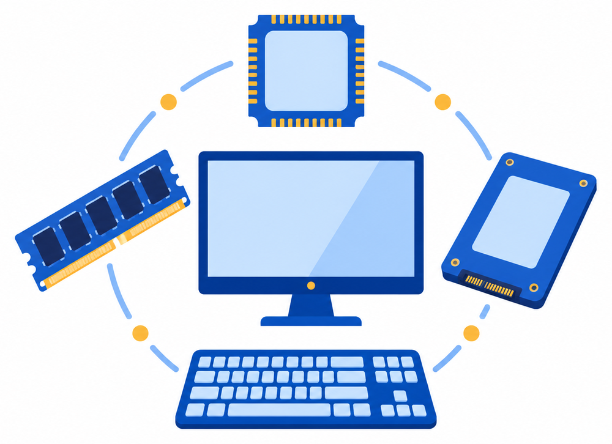
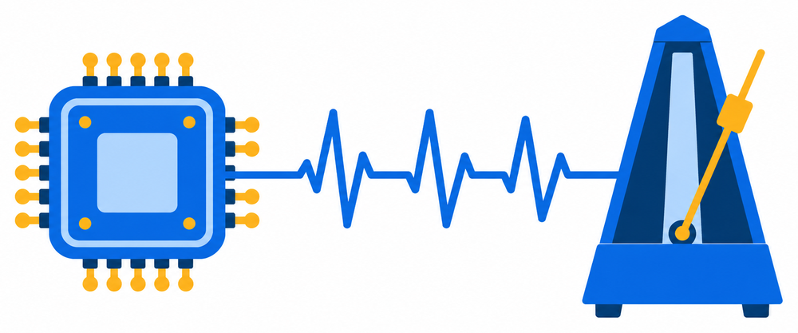

# 1. Zamonaviy kompyuterlar va ularning arxitekturasi

I bob. Kompyuter savodxonligi va arxitekturasi · 1 ta nazariy dars

Ma'ruza taqdimoti: [Zamonaviy kompyuterlar va ularning arxitekturasi (PPTX)](../../downloads/axv/topic-01/zamonaviy-kompyuterlar.pptx)

Bu sahifa darsdan keyin takrorlash uchun. Unda kompyuter turlari, kompyuterning ishlash tamoyili, uning asosiy qismlari va texnik ko'rsatkichlari tushuntiriladi. Oxirida laboratoriya mashqlari bor.

## Kompyuter turlari va ishlash tamoyili

### Telefon ham kompyuter

Telefoningiz ham kompyuter. Lekin bitta telefon tez ishlaydi, boshqasi sekin. Sababi uning ichidagi qismlarda: **protsessor**, **RAM** va **xotira**. Bu sahifada ularning har biri nima qilishini va raqamlar bilan qanday yozilishini o'rganamiz.


### Kompyuter turlari

Kompyuterlar turlicha, lekin hammasi bir xil ishlaydi.

| Kompyuter | Qayerda ishlatiladi |
|---|---|
| Desktop (stol kompyuteri) | Uyda, ofisda; joyida turadi |
| Laptop (noutbuk) | O'qish va ish; olib yurish mumkin |
| Planshet | O'qish, video, chizish |
| Smartfon | Qo'ng'iroq, internet, kamera; cho'ntakda |
| Server | Saytlar va ma'lumotlarni minglab odamga beradi |

### Server

**Server** boshqa kompyuterlarga so'rov bo'yicha xizmat qiladigan kompyuter. Bu so'zlarni bilib oling:

- **Mijoz** (*client*): so'rov yuboradigan qurilma, masalan telefon yoki noutbuk.
- **So'rov**: "maktab saytini oching" degan talab.
- **Server**: so'rovni qabul qilib, javob beradigan kompyuter.
- **Javob**: server yuborgan sahifa, fayl yoki xabar.

Brauzerda maktab saytining manzilini yozsangiz, telefoningiz (mijoz) serverga so'rov yuboradi. Server saytni topadi va sahifani javob sifatida qaytaradi.

Server ham kompyuter, lekin oddiy kompyuterdan farq qiladi:

| Oddiy kompyuter | Server |
|---|---|
| Bitta odam ishlatadi | Minglab odamga xizmat qiladi |
| Kerak bo'lganda yoqiladi | Kunu-tun ishlaydi |
| Monitor va klaviatura bor | Ko'pincha monitorsiz, maxsus xonada turadi |

Serverning ichida ham xuddi shu qismlar bor: protsessor, RAM va xotira. Faqat ular kuchliroq va ko'proq.

**Savol.** Qaysi kompyuter bir vaqtda minglab odamga sayt va ma'lumot beradi? Smartfon, planshet, server yoki noutbuk?

**Javob.** Server. Smartfon, planshet va noutbuk bir odam uchun mo'ljallangan.

### Kompyuter to'rt qadamni bajaradi

Har qanday kompyuter to'rt qadamni bajaradi:

1. **Kiritish** (*Input*): kompyuterga ma'lumot beramiz.
2. **Ishlov** (*Processing*): protsessor ma'lumot ustida ish bajaradi.
3. **Saqlash** (*Storage*): natija xotirada turadi.
4. **Chiqarish** (*Output*): natijani ko'ramiz yoki eshitamiz.

```text
Klaviatura  →  CPU  →  RAM / xotira  →  Monitor
 kiritish      ishlov     saqlash        chiqarish
```

Telefonda rasmga olish ham shu to'rt qadamdan o'tadi:

```text
Kamera  →  CPU  →  Xotira  →  Ekran
kiritish   ishlov   saqlash   chiqarish
```

Kamera yorug'likni ma'lumotga aylantiradi, protsessor uni rasmga aylantiradi, rasm xotiraga yoziladi va ekranda ko'rinadi. Bularning hammasi bir soniyadan kam vaqt oladi.

### Kiritish va chiqarish qurilmalari

**Kiritish qurilmasi** kompyuterga ma'lumot beradi. **Chiqarish qurilmasi** kompyuterdan ma'lumot oladi.

| Kiritish qurilmalari | Chiqarish qurilmalari |
|---|---|
| Klaviatura, sichqoncha | Monitor, kolonka |
| Mikrofon, kamera | Printer, proyektor |
| Skaner | |

**Sensorli ekran** (*touchscreen*) ikkalasi ham: barmoq bilan bosamiz (kiritish) va tasvirni ko'ramiz (chiqarish).

## Asosiy qismlar: protsessor, RAM, xotira

### Qismlar xaritasi

Kompyuter bir nechta qismdan iborat va ular birga ishlaydi:

- **Protsessor** (CPU): ishlov beradi.
- **RAM**: tez, vaqtinchalik xotira.
- **SSD yoki HDD**: doimiy xotira.
- **Monitor, klaviatura**: chiqarish va kiritish.



### Protsessor

**Protsessor** (CPU, *Central Processing Unit*, markaziy ishlov qurilmasi) kompyuterning miyasi: u hamma buyruqni bajaradi. Odam miyasi tanani boshqargani kabi, protsessor kompyuterni boshqaradi. U hisoblaydi, solishtiradi va ma'lumotni qismlarga uzatadi.


### Protsessor nomi

Protsessorni **Intel** va **AMD** kompaniyalari ishlab chiqaradi. Nomidagi raqam odatda uning kuchini ko'rsatadi:

| Nom | Ma'nosi |
|---|---|
| Intel Core | i3, i5, i7: raqam kattaroq bo'lsa, odatda kuchliroq |
| AMD Ryzen | 3, 5, 7: xuddi shunday |
| Avlod | ishlab chiqarilgan yil guruhi; yangi avlod odatda tezroq |

Raqamlarni faqat bir xil avlod ichida solishtiring. Eski avlod i5 yangi avlod i3 dan sekin bo'lishi mumkin.

### GHz: protsessor tezligi

Protsessor ichida ko'rinmas soat bor. U juda tez tik-tik qiladi, va har tik-tikda protsessor kichik qadam qo'yadi. Protsessor bir sekundda necha marta tik-tik qilishini **GHz** (gigagerts) bildiradi. **Giga** (G) milliard degani.

| Tezlik | Bir sekundda |
|---|---|
| 2 GHz | 2 milliard tik-tik |
| 3 GHz | 3 milliard tik-tik |
| 4 GHz | 4 milliard tik-tik |

GHz katta bo'lsa, bitta ish tezroq bajariladi.



### Yadro: protsessor ichidagi ishchi

**Yadro** (*core*) protsessor ichidagi ishchi. Har bir yadro o'z ishini bajaradi, shuning uchun yadro ko'p bo'lsa, ishlar bir vaqtda bajariladi:

- 1 yadro bir vaqtda 1 ta ish bajaradi.
- 4 yadro bir vaqtda 4 ta ish bajaradi.
- 8 yadro bir vaqtda 8 ta ish bajaradi.

Do'konda bitta kassa bo'lsa, hamma uzun navbatda turadi. To'rtta kassa bo'lsa, to'rt kishi bir vaqtda xizmat oladi. Brauzer, musiqa va hujjat bir vaqtda ochiq bo'lsa, ko'p yadro hammasiga yetib boradi.


**Savol.** A protsessor: 4 GHz, 2 yadro. B protsessor: 3 GHz, 8 yadro. Ko'p dastur ochiq bo'lsa, qaysi biri yaxshi?

**Javob.** B, chunki yadro ko'p. GHz bitta ishni tezlashtiradi, lekin ko'p ishni bir vaqtda bajarish uchun yadro kerak.

### RAM va xotira

**RAM** — tezkor, vaqtinchalik xotira. **Xotira** (SSD yoki HDD) — fayllarni doimiy saqlaydigan qism. Ularni ish stoli va shkafga o'xshatish mumkin:

- **RAM (ish stoli):** juda tez, hozirgi ishlar shu yerda turadi. Elektr o'chsa, tozalanadi.
- **Xotira (shkaf):** sekinroq, lekin fayllar doimiy saqlanadi.


### Dastur ochilganda nima bo'ladi

Dastur fayli xotirada (shkafda) turadi. Uni ochganingizda, u RAM'ga (ish stoliga) ko'chiriladi. Sababi: protsessor juda tez ishlaydi, xotira esa undan sekinroq. Protsessor RAM'dagi nusxa bilan ishlaydi va natijani ekranda ko'rasiz.

```text
SSD (xotira)  →  RAM  →  CPU  →  Ekran
 saqlanadi     yuklanadi  hisoblaydi  ko'rsatadi
```

Shuning uchun RAM ko'p bo'lsa, ko'p dastur bir vaqtda ochiq tura oladi.

**Savol.** Hujjat saqlanmagan holda kompyuterning elektri o'chdi. Nima yo'qoladi?

**Javob.** RAM'dagi saqlanmagan ish yo'qoladi. RAM vaqtinchalik xotira: elektr o'chsa, ichidagi narsa tozalanadi. SSD'dagi fayllar esa qoladi.

### SSD va HDD

SSD va HDD ikkalasi ham fayllarni doimiy saqlaydi. Farqi tezlikda:

| Tur | Izoh |
|---|---|
| SSD | zamonaviy xotira turi; tez ishlaydi |
| HDD | eskiroq xotira turi; odatda sekinroq |

SSD'li kompyuter tez yoqiladi va dasturlar tez ochiladi. Ularning ichki tuzilishini [4-mavzu](topic-04.md)da ko'ramiz.

### GPU (qo'shimcha)

**GPU** — grafik protsessor: tasvir, o'yin va video bilan ishlaydi. Ikki turi bor:

- **Integrated**: protsessor ichida; oddiy ishga yetadi.
- **Dedicated**: alohida karta; o'yin va video montaj uchun.

## Xususiyatlarni o'qish va taqqoslash

### Texnik xususiyatlar

Kompyuterning tavsifida to'rtta ko'rsatkichni qidiring:

| Xususiyat | Birlik | Misol |
|---|---|---|
| Protsessor tezligi | GHz | 3.5 GHz |
| Yadro soni | ta | 8 yadro |
| RAM | GB | 16 GB |
| Xotira | GB yoki TB | 512 GB, 1 TB |

Bu yerda 1 TB = 1024 GB (o'lchov birliklari haqida [3-mavzuda](topic-03.md) batafsil).

### Nega bu muhim

Zamonaviy dasturlar kuchli kompyuter talab qiladi. Brauzerda ko'p oyna ochilsa, RAM tez to'ladi. O'yin, video va sun'iy intellekt dasturlari ko'p RAM va kuchli protsessor istaydi. Quyidagi qiymatlar taxminiy, ularni kompyuter ishlab chiqaruvchilari tavsiya qiladi:

| Ish turi | RAM (taxminan) |
|---|---|
| Oddiy ish: matn, brauzer | 8 GB |
| Ko'p dastur bir vaqtda | 16 GB |
| Montaj, o'yin, sun'iy intellekt | 32 GB |

Shuning uchun kompyuter tanlashdan oldin uning xususiyatlarini o'qiy olish muhim.

### Kompyuter eng kuchsiz qismi darajasida ishlaydi

Bitta kuchli qism butun kompyuterni tezlashtirmaydi. Qismlar bir-biriga mos bo'lishi kerak:

| | CPU | RAM | Natija |
|---|---|---|---|
| P | i7 | 4 GB | Sekin |
| Q | i5 | 16 GB | Tez |

P kompyuterda protsessor kuchli, lekin RAM 4 GB. Ko'p dastur ochilganda u sekinlashadi. Shuning uchun faqat bitta ko'rsatkichga emas, hammasiga qarang.

### Ikki kompyuterni taqqoslash

| | Laptop A | Laptop B |
|---|---|---|
| Protsessor | Core i3 | Core i5 |
| RAM | 4 GB | 16 GB |
| Xotira | 128 GB SSD | 512 GB SSD |

**Laptop B Laptop A'dan har uchala ko'rsatkichda kuchli**: protsessori kuchliroq, RAM'i to'rt baravar ko'p, xotirasi to'rt baravar katta. Javobni doim raqamlar bilan asoslang.

### Uch kompyuter, uch odam

| | Protsessor | Yadro | RAM | Xotira |
|---|---|---|---|---|
| X | Core i3 | 2 | 4 GB | 128 GB SSD |
| Y | Core i5 | 6 | 16 GB | 512 GB SSD |
| Z | Core i7 | 8 | 32 GB | 1 TB SSD |

**Savol.** Maktab o'quvchisi, ofis xodimi va video muharriri uchun bittadan kompyuter tanlang. Sababini RAM va yadro soni bilan ayting.

**Javob.**

- **Maktab o'quvchisi:** X yoki Y. Matn va brauzer uchun 8 GB RAM yetadi; X'dagi 4 GB kamroq bo'lishi mumkin, shuning uchun Y xavfsizroq tanlov.
- **Ofis xodimi:** Y. Ko'p dastur bir vaqtda ochiq turadi: 16 GB RAM va 6 yadro bunga yetadi.
- **Video muharriri:** Z. Montaj og'ir ish: 32 GB RAM va 8 yadro kerak.

O'quvchiga Z shart emas: oddiy ish uchun 8 GB RAM yetadi, qimmat ko'rsatkich ortiqcha bo'ladi. Eng kuchli emas, vazifaga mos kompyuterni tanlang.

## Odatiy xatolar

- **"Telefon kompyuter emas."** Telefon ham kompyuter: unda protsessor, RAM va xotira bor.
- **"GHz katta bo'lsa, kompyuter doim tez."** GHz bitta ishni tezlashtiradi. Ko'p ish bir vaqtda ochiq bo'lsa, yadro soni ham muhim.
- **"i7 doim i5 dan tez."** Raqamlarni faqat bir xil avlod ichida solishtiring.
- **RAM va xotirani adashtirish.** "16 GB" RAM bo'lishi mumkin, "512 GB" xotira bo'lishi mumkin. Ular turli qismlar: RAM tez va vaqtinchalik, xotira doimiy.
- **Saqlamasdan ishlash.** Hujjat saqlanmaguncha u faqat RAM'da turadi. Elektr o'chsa, yo'qoladi. Ishni tez-tez saqlang.
- **Bitta ko'rsatkichga qarab tanlash.** Kompyuter eng kuchsiz qismi darajasida ishlaydi: protsessor, RAM va xotiraga birga qarang.
- **Sensorli ekranni faqat chiqarish qurilmasi deb o'ylash.** U ham kiritadi (bosish), ham chiqaradi (tasvir).

## Laboratoriya mashqlari

Mashqlar faqat shu darsda o'tilgan mavzular asosida. Javoblarni daftarga yoki Word faylga yozing, so'ng "Javob" qismini ochib tekshiring.

### 1-mashq. Qurilmalarni guruhlash

Quyidagi qurilmalarni **kiritish**, **chiqarish** yoki **ikkalasi** ustunlariga ajrating:

klaviatura, monitor, mikrofon, printer, sensorli ekran, skaner, kolonka, veb-kamera, proyektor, sichqoncha.

??? note "Javob"
    | Kiritish | Chiqarish | Ikkalasi |
    |---|---|---|
    | klaviatura, mikrofon, skaner, veb-kamera, sichqoncha | monitor, printer, kolonka, proyektor | sensorli ekran |

### 2-mashq. Qaysi kompyuter turi?

Har bir vaziyat uchun eng mos kompyuter turini yozing (desktop, laptop, planshet, smartfon yoki server):

1. Maktab sayti minglab o'quvchiga ochilishi kerak.
2. Xodim ofisda doim bir joyda o'tirib ishlaydi.
3. O'quvchi darsga olib boradigan kompyuterda matn yozadi.
4. Yo'lda video ko'rish va rasm chizish kerak.
5. Qo'ng'iroq qilish va rasmga olish kerak; u cho'ntakda turishi kerak.

??? note "Javob"
    1. Server. 2. Desktop. 3. Laptop. 4. Planshet. 5. Smartfon.

### 3-mashq. To'rt qadam

Quyidagi ikki holat uchun jadvalni to'ldiring: har bir qadamda nima qurilma yoki qism ishlaydi va nima bo'ladi?

| Holat | Kiritish | Ishlov | Saqlash | Chiqarish |
|---|---|---|---|---|
| Kalkulyatorda 5 + 3 ni hisoblash | | | | |
| Mikrofon bilan ovoz yozib, uni tinglash | | | | |

??? note "Javob"
    | Holat | Kiritish | Ishlov | Saqlash | Chiqarish |
    |---|---|---|---|---|
    | Kalkulyatorda 5 + 3 | klaviatura yoki sensorli ekran: raqamlarni terish | protsessor 5 va 3 ni qo'shadi | natija RAM'da turadi | ekranda 8 ko'rinadi |
    | Ovoz yozish va tinglash | mikrofon: ovozni qabul qiladi | protsessor ovozni faylga aylantiradi | fayl xotiraga yoziladi | kolonka ovozni chiqaradi |

### 4-mashq. Qismlar nima qiladi?

1. Quyidagi qismlarni ularning vazifasi bilan juftlang:

    | Qism | Vazifa |
    |---|---|
    | 1. Protsessor (CPU) | a) fayllarni doimiy saqlaydi |
    | 2. RAM | b) tasvir, o'yin va video bilan ishlaydi |
    | 3. SSD | c) buyruqlarni bajaradi, kompyuterning miyasi |
    | 4. GPU | d) hozir ishlayotgan dasturlarni vaqtincha saqlaydi |

2. Hujjat saqlanmagan holda kompyuterning elektri o'chdi. Nima yo'qoladi va nega?
3. Siz dasturni ochdingiz. U qayerdan qayerga ko'chadi va nega?

??? note "Javob"
    1. 1 — c, 2 — d, 3 — a, 4 — b.

    2. RAM'dagi saqlanmagan ish yo'qoladi, chunki RAM vaqtinchalik xotira: elektr o'chsa, ichidagi narsa tozalanadi. SSD'dagi fayllar qoladi.

    3. Dastur xotiradan (SSD) RAM'ga ko'chadi. Sababi: protsessor juda tez ishlaydi, xotira esa sekinroq, shuning uchun protsessor RAM'dagi nusxa bilan ishlaydi.

### 5-mashq. Xususiyatlarni o'qing va tanlang

Quyida to'rtta kompyuterning xususiyatlari berilgan:

| | Protsessor | Yadro | RAM | Xotira |
|---|---|---|---|---|
| K | Core i3 | 2 | 8 GB | 256 GB SSD |
| L | Core i5 | 6 | 16 GB | 512 GB SSD |
| M | Core i7 | 8 | 32 GB | 1 TB SSD |
| N | Core i7 | 8 | 4 GB | 1 TB HDD |

1. Maktab o'quvchisi (matn, brauzer), ofis xodimi (ko'p dastur bir vaqtda) va video muharriri uchun bittadan kompyuter tanlang. Sababini RAM va yadro soni bilan yozing.
2. Qaysi kompyuterning bitta qismi boshqalariga mos kelmaydi? Nima uchun u sekin ishlaydi?
3. Protsessor A: 4 GHz, 2 yadro. Protsessor B: 3 GHz, 8 yadro. Bitta og'ir ish uchun qaysi biri tezroq? Ko'p dastur bir vaqtda ochiq bo'lsa-chi?
4. M kompyuterning xotirasi necha GB? (1 TB = 1024 GB.)

??? note "Javob"
    1. **O'quvchi:** K. Oddiy ish uchun 8 GB RAM yetadi, qimmatroq kompyuter shart emas. **Ofis xodimi:** L. Ko'p dastur bir vaqtda ochiq turadi: 16 GB RAM va 6 yadro bunga yetadi. **Video muharriri:** M. Montaj og'ir ish: 32 GB RAM va 8 yadro kerak.

    2. N kompyuter. Protsessori kuchli (Core i7, 8 yadro), lekin RAM'i atigi 4 GB, xotirasi esa HDD (odatda SSD'dan sekinroq). Kompyuter eng kuchsiz qismi darajasida ishlaydi, shuning uchun ko'p dastur ochilganda sekinlashadi.

    3. Bitta og'ir ish uchun A tezroq: GHz katta bo'lsa, bitta ish tezroq bajariladi. Ko'p dastur bir vaqtda ochiq bo'lsa, B yaxshi, chunki yadro ko'p.

    4. 1 TB = 1024 GB.
