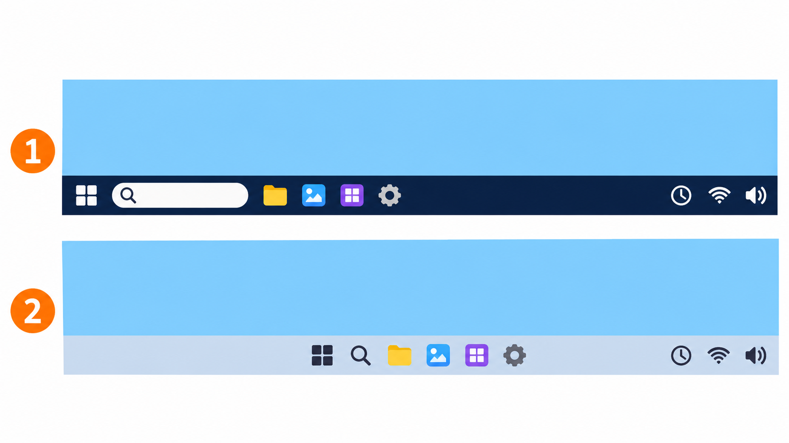
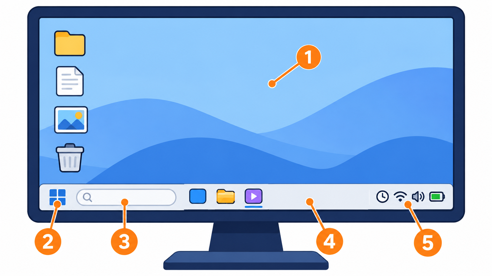
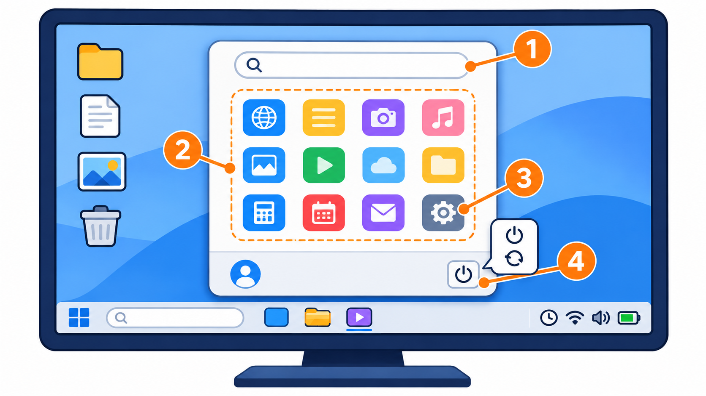
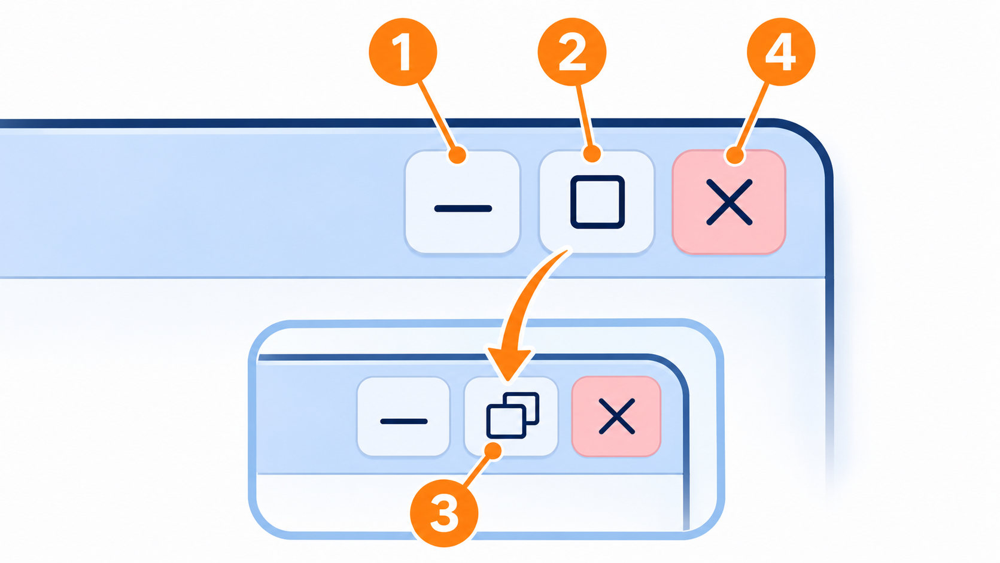
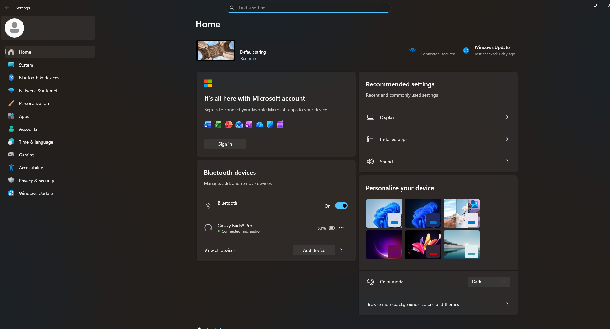
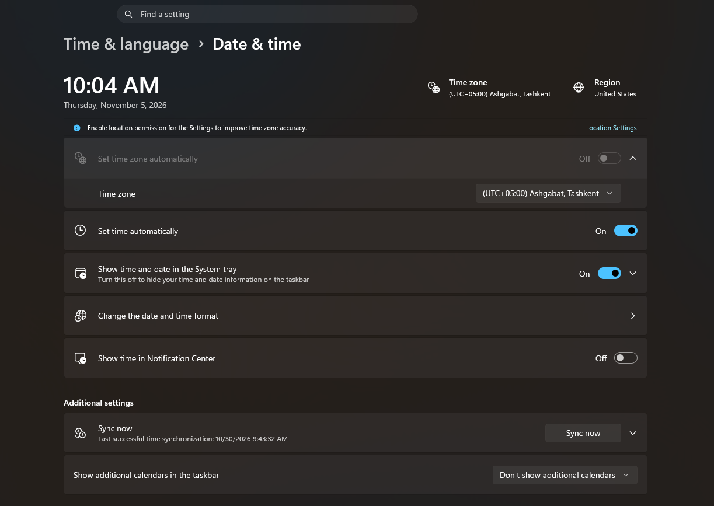
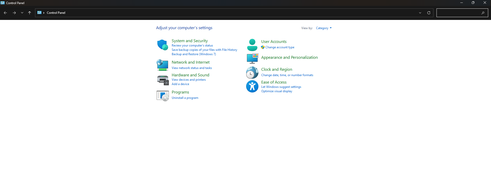
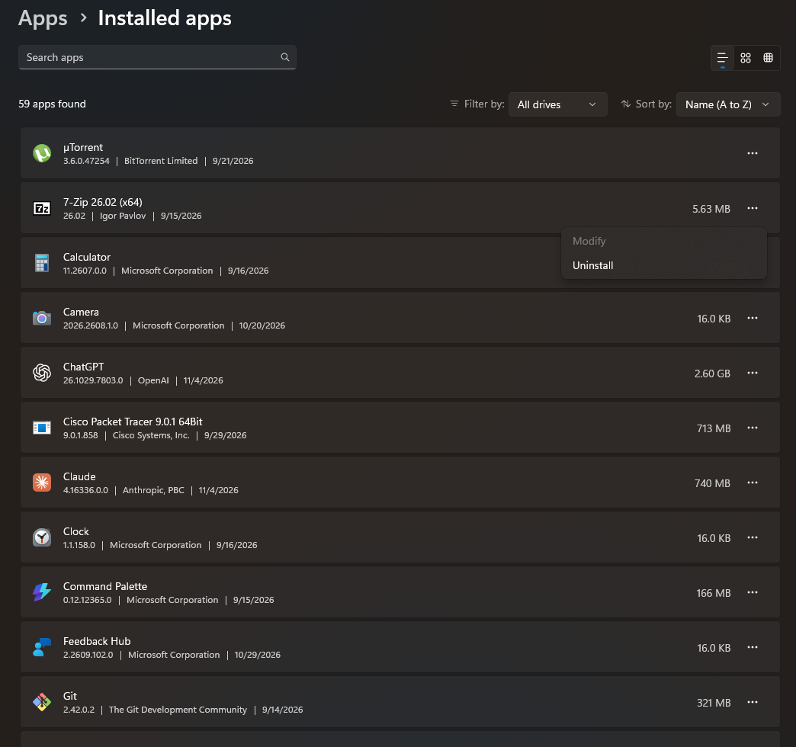

# 2. Operatsion tizimlar va Windows muhitida ishlash

I bob. Kompyuter savodxonligi va arxitekturasi · 1 ta nazariy dars

Ma'ruza taqdimoti: [Zamonaviy kompyuterlar va Windows (PDF)](../../downloads/axv/topic-02/kompyuterlar-va-windows.pdf)

Bu sahifa darsdan keyin takrorlash uchun. Taqdimot ikki mavzuni birga o'z ichiga oladi. Kompyuter turlari va qismlari (CPU, RAM, SSD, kiritish va chiqarish qurilmalari) [1-mavzu sahifasida](topic-01.md) tushuntirilgan. Bu sahifada esa taqdimotning ikkinchi qismi: operatsion tizim, Windows muhiti, oynalar, sozlamalar, sana, vaqt va til, Control Panel hamda dasturlarni o'rnatish va o'chirish.

## Operatsion tizim

### Operatsion tizim nima

Kompyuterda uch tomon bor: siz (foydalanuvchi), dasturlar va qurilmalar (protsessor, xotira, ekran, klaviatura). Dasturlar qurilmalar bilan to'g'ridan-to'g'ri gaplashmaydi: ular buni operatsion tizim orqali qiladi.

**Operatsion tizim** (*Operating System*, qisqacha **OS**) — foydalanuvchi, dasturlar va kompyuter qurilmalari o'rtasidagi vositachi.

Masalan, siz Word'da hujjatni chop etish tugmasini bosasiz. Word printer bilan o'zi gaplashmaydi: u buni operatsion tizimga aytadi, operatsion tizim esa printerga yuboradi. Rasmdagi o'rtadagi yordamchi — operatsion tizim.

Kompyuter yoqilganda operatsion tizim yuklanadi, ya'ni xotiradan RAM'ga o'tib ishga tushadi. Boshqa hamma dasturlar undan keyin, uning yordamida ishlaydi.

### Operatsion tizimning vazifalari

| Vazifa | Nima qiladi |
|---|---|
| Qurilmalarni boshqarish | klaviatura, sichqoncha, ekran, printer bilan ishlaydi |
| Fayllarni boshqarish | fayllarni xotirada saqlaydi, topadi va ochadi |
| Dasturlarni ishga tushirish | dasturni ochadi va unga protsessor vaqtini hamda RAM'dan joy beradi |
| Foydalanuvchilarni boshqarish | bitta kompyuterda har kimning o'z akkaunti va fayllari bo'ladi |
| Xavfsizlikni ta'minlash | parol so'raydi, begona odamni va zararli dasturlarni to'sishga yordam beradi |

**Akkaunt** — kompyuter yoki saytdagi shaxsiy hisobingiz: ismingiz, parolingiz va sozlamalaringiz.

Windows'da ko'radigan ish stoli, Start menyusi va Settings — bularning hammasi operatsion tizimning o'zi.

### Operatsion tizim turlari

| Operatsion tizim | Qayerda ishlaydi |
|---|---|
| Windows | ko'pchilik kompyuter va noutbuklar |
| Linux | serverlar va ba'zi kompyuterlar |
| macOS | Apple kompyuterlari (MacBook, iMac) |
| Android | ko'pchilik smartfon va planshetlar |
| iOS | Apple telefonlari (iPhone) |

Telefon ham kompyuter, shuning uchun unda ham operatsion tizim bor. Biz darslarda Windows bilan ishlaymiz.

**Savol.** Windows nima: A) CPU, B) SSD, C) Operatsion tizim?

**Javob.** C) Operatsion tizim. CPU buyruqlarni bajaradigan qurilma, SSD esa ma'lumotni saqlaydigan qurilma. Windows esa qurilma emas, dastur: u qurilmalarni boshqaradi.

## Windows muhiti

### Kompyuteringizda qaysi Windows?

Maktab kompyuterlarida Windows 10 yoki Windows 11 bo'lishi mumkin. Ularning ko'rinishi biroz farq qiladi.

- **Taskbar'ga (ekranning pastidagi uzun chiziqqa) qarang.** Windows 11'da Start va ikonkalar odatda pastda, o'rtada turadi. Windows 10'da Start chap burchakda.
- **Aniq bilish uchun:** Search'ga (Taskbar'dagi lupa ikonkasi yoki qidiruv qatori) `winver` deb yozing va Enter bosing. Ochilgan oynada Windows versiyasi yozilgan.

1. Windows 10: Start chapda.
2. Windows 11: Start o'rtada.

Windows yozuvlari inglizcha yoki ruscha bo'lishi mumkin; bu **interfeys tili**. **Interfeys** — dasturdagi tugma, menyu va yozuvlar. Bu sahifada nomlar inglizcha, yonida ruschasi berilgan.

### Windows ish stolining asosiy elementlari

[1-mavzuda](topic-01.md) RAM'ni ish stoliga o'xshatgan edik. Bu boshqa narsa: bu yerda ish stoli (*Desktop*) — ekrandagi joy.

Windows yoqilganda ko'radigan birinchi ekraningiz — ish stoli. Ekranda beshta asosiy element bor:

| № | Element | RU | Nima |
|---|---|---|---|
| 1 | Desktop (ish stoli) | Рабочий стол | oynalar orqasidagi asosiy maydon; unda dastur va fayllarning ikonkalari turadi |
| 2 | Start | Пуск | ekranning pastidagi Windows ikonkasi; bossangiz Start menyusi ochiladi |
| 3 | Search (qidiruv) | Поиск | Taskbar'dagi lupa ikonkasi yoki qidiruv qatori; dastur, fayl yoki sozlamani nomi bo'yicha topadi |
| 4 | Taskbar (vazifalar paneli) | Панель задач | ekranning pastidagi uzun chiziq; ochiq dasturlar shu yerda ko'rinadi |
| 5 | Notification Area (bildirishnomalar joyi) | Область уведомлений | Taskbar'ning o'ng burchagi: soat, Wi-Fi, ovoz, batareya va xabarlar |

1. Desktop — ish stoli
2. Start
3. Search — qidiruv
4. Taskbar — vazifalar paneli
5. Notification Area — bildirishnomalar joyi

**Ikonka** — dastur yoki faylni bildiruvchi kichik rasm. Ish stolida ikonkani ikki marta bosasiz. Taskbar va Start menyusida bir marta bosish yetarli.

### Start menyusi

Start tugmasini bossangiz, Start menyusi ochiladi. U orqali:

- **dasturlarni ochasiz:** ro'yxatdan dasturni tanlab bosasiz;
- **qidirasiz:** menyu ochilgach dastur nomini yoza boshlasangiz, Windows uni topib beradi;
- **Settings'ga (sozlamalarga, RU: *Параметры*) kirasiz:** tishli g'ildirak ikonkasi;
- **kompyuterni o'chirasiz yoki qayta yoqasiz:** quvvat (⏻) ikonkasi (RU: *Выключение*).

Windows 10'da Settings va quvvat ikonkalari Start menyusining chap ustunida. Windows 11'da Settings — menyudagi ilovalar orasida, quvvat ikonkasi esa o'ng pastki burchakda.

1. Qidiruv
2. Dasturlar
3. Settings
4. Shut down / Restart

**Shut down** (RU: *Завершение работы*) kompyuterni butunlay o'chiradi. **Restart** (RU: *Перезагрузка*) uni o'chirib, darhol qayta yoqadi. Kompyuter qotib qolsa yoki yangilanishdan keyin Restart so'rasa, shu kerak bo'ladi.

## Oynalar va sozlamalar

### Oyna tugmalari

Har bir dastur o'z **oynasida** ochiladi. Oynaning o'ng yuqori burchagida uchta tugma bor:

| Tugma | Nomi | RU | Nima qiladi |
|---|---|---|---|
| `_` | Minimize (yig'ish) | Свернуть | oynani yashiradi; dastur Taskbar'da qoladi va ishlashda davom etadi |
| `☐` | Maximize (kattalashtirish) | Развернуть | oyna butun ekranni egallaydi va tugma ikki kvadratga aylanadi (**Restore**) |
| ikki kvadrat | Restore (tiklash) | Свернуть в окно | oynani avvalgi o'lchamiga qaytaradi |
| `✕` | Close (yopish) | Закрыть | oynani yopadi; odatda dastur ham to'xtaydi |

1. Minimize
2. Maximize
3. Restore
4. Close

Yig'ilgan oynani qaytarish uchun Taskbar'dagi dastur ikonkasini bosing.

**Savol.** Siz Word'da yozyapsiz va brauzerga o'tmoqchisiz. Keyin Word'ga uni qayta ochmasdan qaytmoqchisiz. Qaysi tugmani bosasiz: Minimize yoki Close?

**Javob.** Minimize. U oynani faqat yashiradi, Word esa ochiq qoladi: Taskbar'dagi Word ikonkasini bossangiz, oyna qaytadi. Close esa Word'ni yopadi va uni qaytadan ochishga to'g'ri keladi.

### Settings (sozlamalar)

**Settings** — Windows'ning sozlamalar oynasi. Uni Start menyusidan ochasiz.

Settings'da kerakli bo'limni topishning eng oson yo'li — **Search**. Bu Windows 10'da ham, Windows 11'da ham bir xil ishlaydi.

**Qayerda qidirasiz:** Taskbar'dagi lupa ikonkasi yoki qidiruv qatori. Agar u ko'rinmasa, Start'ni bosing va darhol yoza boshlang. Qidiruv o'sha joyda ochiladi.

**Nima deb yozasiz:** interfeys tilida yozing. Inglizcha Windows'da inglizcha, ruscha Windows'da ruscha.

| Nima kerak | Interfeys inglizcha | Interfeys ruscha |
|---|---|---|
| Wi-Fi'ga ulanish | `wi-fi` | `wi-fi` |
| Bluetooth qurilma ulash | `bluetooth` | `bluetooth` |
| Ekran yorug'ligi | `brightness` | `яркость` |
| Ekran o'lchami va sozlamalari | `display` | `дисплей` |
| Ovoz | `sound` | `звук` |
| Akkaunt va parol | `accounts` | `учетные записи` |
| Dasturni o'chirish | `add or remove programs` | `установка и удаление программ` |
| Sana va vaqt | `date and time` | `дата и время` |
| Til | `language` | `язык` |
| Windows yangilanishi | `windows update` | `центр обновления` |
| Control Panel | `control panel` | `панель управления` |
| Windows versiyasi | `winver` | `winver` |

Rasmda Windows 11'dagi Settings oynasi. Chap ro'yxatda bo'limlar bor: System, Network & internet, Apps, Accounts, Time & language, Windows Update. Yuqoridagi **Find a setting** qatori ham qidiruv: unga ham yozish mumkin.

Windows Update'ni o'chirmang: yangilanishlar xatolarni tuzatadi va kompyuterni xavfsizroq qiladi.

### Sana, vaqt va til

**Nega kerak:** kompyuter soati noto'g'ri bo'lsa, ba'zi saytlar ochilmaydi va fayllar noto'g'ri sana bilan saqlanadi.

**Vaqtni to'g'rilash**

1. Search'ga `date and time` (ruscha: `дата и время`) deb yozing va **Date & time settings** (*Параметры даты и времени*) ni oching. Boshqa yo'l: Taskbar'dagi soatni sichqonchaning o'ng tugmasi bilan bosib, **Adjust date and time** (*Настроить дату и время*) ni tanlang. Windows 10'da bu yozuv biroz boshqacha bo'lishi mumkin.
2. **Set time automatically** (*Установить время автоматически*) ni yoqing. Shunda Windows vaqtni internetdan oladi.
3. **Time zone** (*Часовой пояс*) — vaqt mintaqasi: O'zbekiston uchun **(UTC+05:00) Ashgabat, Tashkent** (*Ашхабад, Ташкент*).

**Administrator** — kompyuterda hamma narsani o'zgartirishga ruxsati bor akkaunt. Maktab kompyuterida vaqtni o'zgartirish uchun Windows administrator parolini so'rashi mumkin. Shunda o'qituvchiga ayting.

**Til: ikki xil narsa**

| Nima | Qayerda | Nimani o'zgartiradi |
|---|---|---|
| Klaviatura tili | Taskbar'ning o'ng tomonidagi `ENG` / `РУС` yozuvi | qaysi harflar yozilishini. O'zbek lotin harflarida yozish uchun odatda `ENG` ishlatiladi |
| Interfeys tili | Search: `language` / `язык` → **Windows display language** (*Язык интерфейса Windows*) | Windows'dagi hamma menyu va tugmalarning tilini |

Klaviatura tilini almashtirish uchun `ENG` / `РУС` yozuvini bosing va tilni tanlang yoki **Win + Space** tugmalarini bosing. **Win** — klaviaturadagi Windows ikonkasi chizilgan tugma, **Space** — probel. Maktab kompyuterida interfeys tilini o'zgartirmang: menyular boshqa tilga o'tadi va keyingi o'quvchi qiynaladi.

### Control Panel

**Control Panel** (boshqaruv paneli, RU: *Панель управления*) — Windows'ning eski sozlamalar oynasi. Yangi Windows'da ko'p sozlamalar Settings'ga ko'chgan, lekin Control Panel hali ham bor va ba'zi ishlar uchun kerak bo'ladi.

**Ochish:** Search'ga `control panel` (ruscha: `панель управления`) deb yozing va natijani bosing. Start menyusida u ro'yxatning chuqur joyida, shuning uchun qidiruv eng oson yo'l.

Oyna ochilganda o'ng yuqorida **View by: Category** (*Просмотр: Категория*) tanlangan bo'lsin. Shunda bo'limlar guruhlab ko'rsatiladi:

| Bo'lim (EN) | RU | Nima uchun |
|---|---|---|
| Programs → Uninstall a program | Программы → Удаление программы | dasturni o'chirish |
| Clock and Region | Часы и регион | sana, vaqt va mintaqa |
| Hardware and Sound | Оборудование и звук | printer, ovoz |
| User Accounts | Учетные записи пользователей | akkauntlar |

Settings va Control Panel'dagi ko'p sozlamalar bir xil. Qaysi biridan foydalanish ixtiyoriy.

### Dastur o'rnatish va o'chirish

**Dastur o'rnatish** — dasturni kompyuterga yozib, ishlashga tayyorlash.

**O'rnatishning ikki yo'li:**

1. **Microsoft Store** — Windows'dagi rasmiy dasturlar do'koni. Uni oching, dasturni qidiring va **Get** yoki **Install** (*Получить* / *Установить*) ni bosing.
2. **Dasturning rasmiy sayti** — o'rnatuvchi faylni yuklab oling va ishga tushiring.

O'rnatishda Windows **"Do you want to allow this app to make changes to your device?"** (*«Разрешить этому приложению вносить изменения на вашем устройстве?»*) deb so'raydi. Dastur rasmiy manbadan bo'lsa, **Yes** (*Да*) ni bosing. Qayerdanligini bilmasangiz, **No** (*Нет*) ni bosing.

**Dasturni o'chirish.** Eng oson yo'l: Search'ga `add or remove programs` (ruscha: `установка и удаление программ`) deb yozing. Ochilgan ro'yxatda dasturni toping:

- **Windows 11:** dastur yonidagi uch nuqta (`…`) → **Uninstall** (*Удалить*).
- **Windows 10:** dasturni bosing → **Uninstall** (*Удалить*).

Boshqa yo'l: Control Panel → Programs → Uninstall a program, dasturni tanlang va **Uninstall** ni bosing.

Ish stolidagi ikonka ko'pincha faqat **yorliq** (*Shortcut*, RU: *Ярлык*): dasturga olib boradigan ko'rsatkich. Yorliqni o'chirsangiz, dastur kompyuterda qoladi.

Yorliq — yo'l ko'rsatkichi, dastur — uy. Ko'rsatkichni olib tashlasangiz, uy joyida qoladi.

Dasturlarni faqat ishonchli manbalardan yuklang: dasturning rasmiy saytidan yoki Microsoft Store'dan. Notanish saytlardagi "bepul" dasturlar ichida zararli dastur bo'lishi mumkin. Bu haqda [6-mavzuda](topic-06.md) batafsil gaplashamiz.
