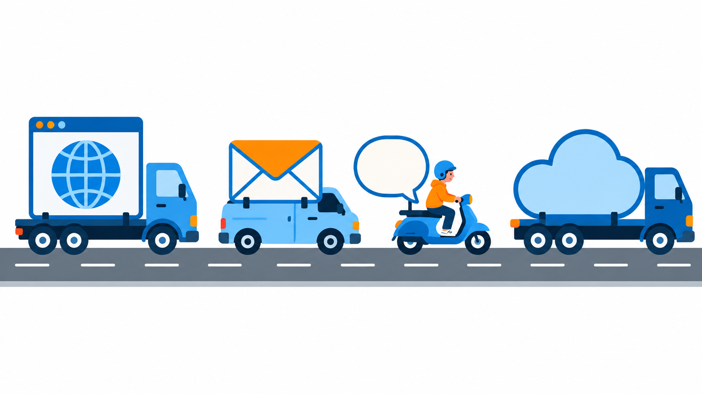

# 5. Internet, brauzerlar va elektron pochta bilan ishlash

I bob. Kompyuter savodxonligi va arxitekturasi · 1 ta amaliy dars

Ma'ruza taqdimoti: [Internet, brauzerlar va elektron pochta bilan ishlash (PPTX)](../../downloads/axv/topic-05/internet-brauzer-pochta.pptx)

Bu sahifa darsdan keyin takrorlash uchun. Unda internet va uning xizmatlari, brauzer bilan ishlash, qidiruv, elektron pochta va fishingdan saqlanish tushuntiriladi.

## Internet va brauzer

### Internet va veb

**Internet** — dunyo bo'ylab bir-biriga ulangan kompyuterlar tarmog'i. **Veb** — internetdagi saytlar. Veb internetning faqat bir xizmati.

Internetni yo'lga o'xshating. Yo'lda turli mashinalar yuradi: biri sayt, biri xat, biri xabar, biri bulut olib yuradi. Veb-sayt shu mashinalardan faqat bittasi.



### Internetning asosiy xizmatlari

**Xizmat** — internet orqali ishlaydigan imkoniyat.

| Xizmat | Misol |
|---|---|
| Veb | Maktab sayti, Wikipedia |
| Elektron pochta | Gmail |
| Xabar almashish | Telegram |
| Bulut | Google Drive |

**Bulut** deganda fayllar sizning kompyuteringizda emas, internetdagi serverda turadi. Google Drive shunday.

**Savol.** Internet va veb haqida qaysi gap to'g'ri?

**Javob.** Veb internetdagi xizmatlardan biri. Internet katta tarmoq, veb esa shu tarmoqdagi xizmatlardan biri. Sayt ochish uchun internet kerak, chunki sayt serverda turadi.

### Sayt manzili (URL)

Veb-sayt manzili (**URL**) uch qismdan iborat. Masalan, `https://uzedu.uz/yangiliklar`:

| Qism | Ma'nosi |
|---|---|
| `https://` | ulanish turi; ma'lumot shifrlangan holda boradi |
| `uzedu.uz` | domen: saytning nomi |
| `/yangiliklar` | saytdagi aniq sahifa |

`https` faqat ulanish shifrlanganini bildiradi, saytning ishonchli ekanini emas. Soxta saytlar ham `https` ishlatishi mumkin.

### Domen va IP manzil

Kompyuterlar saytni nom bilan emas, raqam bilan topadi.

- **IP manzil** — har bir kompyuter va serverning raqamli manzili.
- **Domen** — IP manzilning eslab qolish oson nomi, masalan `uzedu.uz`.
- **DNS** — domenni IP manzilga aylantiradigan xizmat.

Buni telefon kitobiga o'xshatish mumkin. Biz do'stimizning ismini eslaymiz (domen), telefon esa raqamni terib qo'ng'iroq qiladi (IP manzil). DNS esa telefon kitobi. IP va DNS haqida [10-mavzuda](topic-10.md) batafsil gaplashamiz.

### Sayt qanday ochiladi

Sayt ochilganda so'rov serverga boradi, javob esa sahifa bo'lib qaytadi:

```text
Brauzer  →  DNS  →  Server  →  Sahifa
manzil      IP manzilni   so'rovni     ekranda
yozasiz     topadi        oladi        chiqadi
```

1. Siz brauzerga manzil yozasiz.
2. Brauzer DNS'dan serverning IP manzilini so'raydi.
3. So'rov provayder (internetga ulaydigan kompaniya) orqali, kabellar bo'ylab serverga boradi.
4. Server sahifani yuboradi va brauzer uni ekranda ko'rsatadi.

Hammasi soniyadan kam vaqt oladi.

### Brauzer

**Brauzer** — saytdan kelgan ma'lumotni sahifa qilib ko'rsatadigan dastur. Hamma brauzer shu ishni qiladi, farqi qulayliklarida.

| Brauzer | Kim yaratgan |
|---|---|
| Chrome | Google |
| Edge | Microsoft |
| Firefox | Mozilla |
| Safari | Apple |

Safari faqat Apple qurilmalarida bor.

### Brauzerning asosiy qismlari

| Qism | Ma'nosi | Tezkor tugma |
|---|---|---|
| Manzil satri | sayt manzili yoziladigan va qidiriladigan joy | |
| Tab | bitta oynada bir nechta sayt | Ctrl+T yangi tab |
| Xatcho'p | sevimli sayt manzilini saqlash | Ctrl+D |
| Tarix | ochilgan saytlar ro'yxati | Ctrl+H |
| Yuklashlar | yuklab olingan fayllar | Ctrl+J |

Tarixni tozalash uchun Ctrl+Shift+Delete bosing va nimani o'chirishni tanlang. Tezkor tugmalar haqida [3-mavzuda](topic-03.md) o'tilgan.

### Kesh

**Kesh** (*cache*) — brauzer ichidagi kichik ombor. Saytning rasmlari va boshqa qismlari birinchi marta serverdan yuklanadi va keshga saqlanadi. Ikkinchi marta ochganingizda ular keshdan olinadi, shuning uchun sayt tez ochiladi.

```text
Birinchi marta  →  Kesh  →  Ikkinchi marta
serverdan          nusxa      keshdan
yuklanadi          saqlanadi  olinadi
```

Kamchiligi: sayt yangilansa, brauzer eski nusxani ko'rsatishi mumkin. Ctrl+F5 sahifani keshsiz qayta yuklaydi.

### Cookie

**Cookie** — sayt sizni eslab qolishi uchun brauzerda saqlanadigan kichik yozuv. Siz saytga kirasiz, sayt brauzerga yozuv qoldiradi: "bu foydalanuvchi kirgan". Keyingi safar yozuvni o'qib, sizni taniydi.

- Cookie tufayli saytga har safar qaytadan kirmaysiz.
- Cookie tilingizni va savatingizni ham eslab qoladi.
- Cookie'ni o'chirsangiz, sayt sizni unutadi va qaytadan kirishingiz kerak bo'ladi.

Ba'zi reklama saytlari cookie orqali qaysi saytlarni ochganingizni kuzatishi mumkin. Shuning uchun cookie'ni vaqti-vaqti bilan tozalash foydali.

### Incognito rejimi

**Incognito** rejimi oyna yopilganda tarixni, cookie'ni va keshni o'chiradi. Chrome'da u Incognito, Edge'da InPrivate deyiladi. U Ctrl+Shift+N bilan ochiladi. Boshqa odamning kompyuterida akkauntga kirganda foydali.

**Savol.** Incognito rejimida sayt ochdingiz. Maktab tarmog'i administratori buni ko'ra oladimi?

**Javob.** Ha, ko'rishi mumkin. Incognito faqat shu kompyuterdagi tarixni saqlamaydi. Internet provayder va maktab tarmog'i esa saytni baribir ko'radi.

## Qidiruv

### Kalit so'zlar

Qidiruv tizimi gapni emas, so'zlarni qidiradi. Ortiqcha so'zlar natijani chalkashtiradi. Qidiruvga to'liq gap emas, asosiy kalit so'zlarni yozing.

| Yomon qidiruv | Yaxshi qidiruv |
|---|---|
| Menga kompyuter protsessori haqida ma'lumot kerak edi | protsessor nima |

### Qidiruv belgilari

Bu belgilar natijani aniq qiladi:

| Belgi | Nima qiladi | Misol |
|---|---|---|
| `" "` | aniq iborani qidiradi | `"operatsion tizim nima"` |
| `-` | so'zni natijadan chiqaradi | `python -ilon` |
| `site:` | faqat bitta sayt ichida qidiradi | `site:wikipedia.org Xorazmiy` |
| `filetype:` | fayl turini tanlaydi | `filetype:pdf informatika` |

`python` so'zi ilonni ham, dasturlash tilini ham bildiradi. Shuning uchun `-ilon` yozib, ilon haqidagi sahifalarni chiqarib tashlaymiz. `site:` va `filetype:` dan keyin probel qo'ymang: `site:wikipedia.org` to'g'ri, `site: wikipedia.org` noto'g'ri.

### Manbani tekshiring

Qidiruv javob topib beradi, lekin javob to'g'ri bo'lishi shart emas. Ishonishdan oldin uchta savolga javob bering:

- **Kim yozgan?** Muallif yoki tashkilot ma'lummi?
- **Qachon yozilgan?** Sana yangimi?
- **Boshqa manbalar ham shuni aytadimi?**

Bu mavzuni [8-mavzuda](topic-08.md) batafsil o'rganamiz.

## Elektron pochta

### Gmail akkaunt yaratish

Gmail akkaunt yaratish bir necha qadamdan iborat:

```text
Ism, familiya  →  Tug'ilgan sana  →  Gmail manzil  →  Parol  →  Rozilik
 yoziladi          kiritiladi         tanlanadi       o'ylab      beriladi
                                                      topiladi
```

Manzil `ism@gmail.com` ko'rinishida bo'ladi; bu yerda `@` "da" degani. Manzilni jiddiy tanlang, chunki u keyinchalik o'qish va ishda ishlatiladi. Parolni hech kimga aytmang. Parol qanday kuchli bo'lishini [6-mavzuda](topic-06.md) o'rganamiz. Google akkaunt uchun yosh talabi bor, odatda 13 yosh.

### Xatning qismlari

| Qism | Ma'nosi |
|---|---|
| To | kimga: xat asosan yuboriladigan odam |
| Cc | nusxa: xabardor odam; hamma ko'radi |
| Bcc | yashirin nusxa; boshqalar ko'rmaydi |
| Subject | mavzu: xat nima haqida ekani |
| Matn | xatning o'zi: nima yozasiz |
| Attachment | biriktirma: xatga qo'shilgan fayl |

Xatlar papkalarda turadi: **Inbox** (kelganlar), **Sent** (yuborilganlar), **Drafts** (qoralamalar), **Spam** va **Trash** (o'chirilganlar).

**Savol.** Qaysi maydondagi manzillarni boshqa qabul qiluvchilar ko'rmaydi?

**Javob.** Bcc. U yashirin nusxa. To va Cc dagi manzillarni hamma ko'radi.

### Yaxshi xat

| Yomon xat | Yaxshi xat |
|---|---|
| Mavzu yo'q | Mavzu: Informatika, 8-sinf, uy vazifasi |
| Salom yo'q | Salom, ismi bilan murojaat |
| Imzo yo'q | Imzo: ism va sinf |

Mavzusiz xat spam bo'lib ketishi mumkin. Salom bilan boshlang, qisqa va aniq yozing, oxirida ismingiz va sinfingizni qo'ying. Faqat BOSH HARFLARDA yozmang: bu baqirish bo'lib eshitiladi.

### Fayl biriktirish

- Skrepka (*Attach files*) bilan fayl biriktiriladi.
- Xatda fayl haqida yozing va fayl nomini aniq qo'ying, masalan `Ism_UyVazifa.pdf`.
- 25 MB dan katta fayl: avval Google Drive'ga yuklang, havolani xatga qo'ying. MB haqida [3-mavzuda](topic-03.md) o'tilgan.

### Javob berish va uzatish

| Tugma | Nima qiladi |
|---|---|
| Reply (Javob) | xatni yuborgan odamga javob yozadi |
| Reply all (Hammaga) | xatdagi hamma odamga javob yuboradi |
| Forward (Uzatish) | xatni boshqa odamga yuboradi |

Hammaga javob berishdan oldin o'ylab ko'ring: javobingizni xatdagi hamma o'qiydi. Shaxsiy gaplarni uzatmang.

## Xavfsizlik: fishing

### Fishing nima

**Fishing** — soxta xabar orqali parol yoki pul olishga urinish. Xabar bankdan, maktabdan yoki do'stdan kelganday ko'rinadi. Maqsad: sizni soxta sahifaga kirgizish va parolni bilib olish.

Nomi inglizcha *fishing* (baliq ovlash) so'zidan: xabar qarmoq, siz esa baliq. Fishing xat orqali ham, Telegram va SMS orqali ham keladi.


### Fishingning beshta belgisi

| Belgi | Misol |
|---|---|
| Shoshirish | "Darhol bosing!", "Bir soatda bloklanadi" |
| Umumiy murojaat | ismingizni emas, "Hurmatli mijoz" deydi |
| G'alati manzil | yuboruvchi manzili rasmiy nomga o'xshash, lekin boshqa |
| Havola | ustiga sichqonchani olib borsangiz, haqiqiy manzil boshqa |
| Kutilmagan fayl | siz kutmagan biriktirma |

Havolani bosmasdan, sichqonchani ustiga olib boring: pastda uning haqiqiy manzili ko'rinadi. Matn bir narsa yozadi, manzil boshqa narsa bo'lishi mumkin. Shoshirish eng ko'p ishlatiladigan usul: u o'ylashga vaqt bermaydi. Bitta belgi ham gumon uyg'otishi kifoya.

### Nima qilish kerak

- Havolani bosmang, faylni yuklamang.
- Javob bermang, parolni hech qachon yozmang.
- Ota-onangiz yoki o'qituvchingizga ko'rsating.

Xabar haqiqiy bo'lsa ham, havolani bosmasdan, rasmiy saytga o'zingiz kirib tekshirgan xavfsizroq. Parolni hech kim, hatto bank yoki maktab ham xat orqali so'ramaydi. Xato bosib yuborgan bo'lsangiz, darhol parolni o'zgartiring va kattalarga ayting.

**Savol.** Xabar: «Hisobingiz bloklanadi! Havolani bosing va parolni kiriting». Nima qilasiz?

**Javob.** Bosmayman va kattalarga ko'rsataman. Shoshirish va parol so'rash fishing belgilari. "Tez bosaman" deyish xato: shoshirish aynan fishing ishlatadigan usul. Parolni yozib javob berish ham xato: fishing aynan shuni xohlaydi.

## Odatiy xatolar

- **"Internet va veb bir xil."** Veb internetning bir xizmati. Xat va xabar almashish ham internetdan foydalanadi, lekin veb-sayt emas.
- **"`https` bo'lsa, sayt ishonchli."** `https` faqat ulanish shifrlanganini bildiradi. Soxta sayt ham `https` ishlatishi mumkin.
- **"Incognito meni hammadan yashiradi."** U faqat shu kompyuterdagi tarixni saqlamaydi. Maktab tarmog'i va provayder saytni ko'radi.
- **Sayt yangilanmaganday ko'rinadi.** Brauzer eski nusxani keshdan ko'rsatayotgan bo'lishi mumkin. Ctrl+F5 bosing.
- **Qidiruvga to'liq gap yozish.** Asosiy kalit so'zlarni yozing; kerak bo'lsa `" "`, `-`, `site:` va `filetype:` ni qo'shing.
- **`site:` dan keyin probel qo'yish.** `site: wikipedia.org` ishlamaydi, `site:wikipedia.org` ishlaydi.
- **Hamma narsaga ishonish.** Topilgan ma'lumotda muallif, sana va boshqa manbani tekshiring.
- **Mavzusiz yoki imzosiz xat yuborish.** Doim mavzu, salom va imzo yozing.
- **Cc va Bcc ni adashtirish.** Cc dagi manzillarni hamma ko'radi, Bcc dagilarni esa yo'q.
- **Katta faylni to'g'ridan biriktirish.** 25 MB dan katta fayl Google Drive orqali yuboriladi.
- **Shoshilib havolani bosish.** Shoshirish fishing belgisi: to'xtang, tekshiring va kattalarga ko'rsating.
